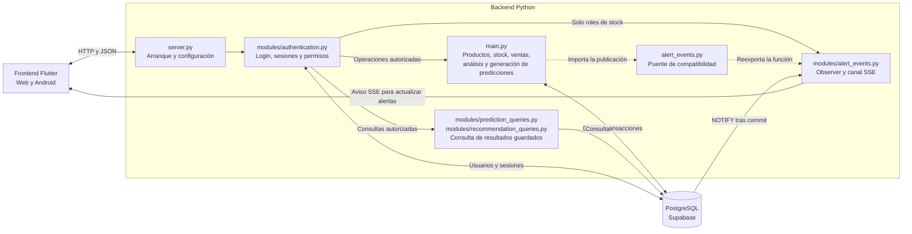

# Componentes actuales de StockIA

Implementación revisada el 25/10/2026. Los bloques del backend son módulos de
una misma aplicación FastAPI.



## Organización de archivos

```text
StockIA/
├── requirements.txt
├── instalar.ps1
├── iniciar-stockia.ps1
├── iniciar-backend.ps1
├── iniciar-web.ps1
├── compilar-apk.ps1
├── backend/
│   ├── main.py
│   ├── server.py
│   ├── alert_events.py
│   ├── modules/
│   │   ├── authentication.py
│   │   ├── prediction_queries.py
│   │   ├── recommendation_queries.py
│   │   └── alert_events.py
│   ├── scripts/
│   │   └── init_auth_db.py
│   ├── sql/
│   ├── tests/
│   ├── requirements.txt
│   └── requirements-dev.txt
├── frontend/
│   ├── lib/
│   │   ├── data/
│   │   ├── models/
│   │   ├── screens/
│   │   └── widgets/
│   ├── test/
│   ├── assets/
│   ├── android/
│   └── web/
├── docs/
└── referencias/frontend-react/
```

Los `__init__.py` de los paquetes Python se omiten del árbol para facilitar la lectura.

## Cómo se conectan

- `server.py` reutiliza la aplicación de `main.py` y registra autenticación,
  consultas, eventos y CORS. El comando de arranque usa `server:app`.
- `main.py` conserva su contenido y la conexión a la base. Autenticación y
  consultas siguen utilizando `main.obtener_conexion()`.
- `backend/alert_events.py` solo reexporta `publish_alert_change` desde
  `modules/alert_events.py`, para conservar los imports originales de `main.py`.
- `scripts/init_auth_db.py` prepara sesiones aplicando `sql/auth_schema.sql`.
  Es una tarea de preparación, no un servicio que quede ejecutándose.
- `iniciar-stockia.ps1` coordina el arranque local; los otros `.ps1` permiten
  iniciar cada parte o compilar Android por separado.
- `instalar.ps1` prepara las dependencias de Python y Flutter desde la raíz.
- XGBoost se ejecuta dentro de `main.py`. La API puede generar predicciones;
  la interfaz actual consulta las que ya están guardadas.
- `referencias/frontend-react/` conserva el front anterior como referencia.

## Ejemplo: venta y actualización de alertas

1. Flutter envía la venta y el token de sesión; el backend verifica permisos.
2. `main.py` registra venta, detalle y movimiento, y descuenta stock. Si
   corresponde, registra una alerta. Publica la señal dentro de esa transacción.
3. PostgreSQL entrega NOTIFY después del commit. Un rollback no entrega el aviso.
4. El Observer avisa por SSE a las sesiones de Administrador y Encargado.
5. Flutter consulta las alertas y actualiza la campanita y la lista abierta.
   Las consultas manuales y automáticas comparten la actualización.

Los avisos SSE requieren la aplicación abierta; no incluyen push con la APK cerrada.

Para preparar y ejecutar el proyecto: [Instalación e inicio](../INSTALACION.md).
