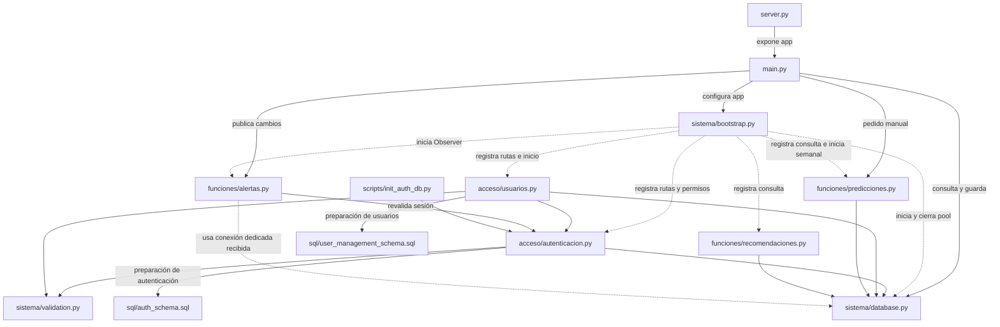

# Organización del backend por responsabilidad

Revisado el 30/10/2026. Se conservan los archivos unificados y se ordenan por su
función: sistema, acceso y funcionalidades complementarias. El traslado sólo
cambia imports y ubicaciones; no cambia rutas, reglas, SQL ni la base.

```text
backend/
├── main.py
├── server.py
├── sistema/
│   ├── bootstrap.py
│   ├── database.py
│   └── validation.py
├── acceso/
│   ├── autenticacion.py
│   └── usuarios.py
├── funciones/
│   ├── predicciones.py
│   ├── recomendaciones.py
│   └── alertas.py
├── scripts/
│   └── init_auth_db.py
├── sql/
│   ├── auth_schema.sql
│   └── user_management_schema.sql
├── tests/
├── requirements.txt
└── requirements-dev.txt
```

Se omiten los `__init__.py`, que declaran los paquetes. Los comandos de instalación
y arranque permanecen en la raíz del proyecto.

## Responsabilidad de cada archivo

| Archivo | Responsabilidad |
| --- | --- |
| `main.py` | Crea app y conserva productos, stock, movimientos, ventas, consultas de alertas, dashboard, análisis individual, generación y decisión de recomendaciones, y la entrada manual de predicciones |
| `server.py` | Reexporta `main.app` para los comandos de ejecución |
| `sistema/bootstrap.py` | Registra rutas, seguridad, CORS y ciclos de vida sobre la misma app |
| `sistema/database.py` | Configuración y pool, conexiones, transacciones y conexión dedicada del Observer |
| `sistema/validation.py` | Validación compartida de contraseñas y errores sin datos sensibles |
| `acceso/autenticacion.py` | Login, logout, usuario actual, contraseña propia, hashes, sesiones y permisos |
| `acceso/usuarios.py` | Alta, edición, estado, rol y restablecimiento de contraseña de usuarios |
| `funciones/predicciones.py` | Consulta guardada, cálculo original compartido y programación semanal |
| `funciones/recomendaciones.py` | Consulta de recomendaciones guardadas; generarlas sigue en main |
| `funciones/alertas.py` | Publicación de cambios, Observer, escucha y eventos SSE |
| `scripts/init_auth_db.py` | Comando de preparación de autenticación |
| `sql/auth_schema.sql` | Preparación de sesiones y seguridad de acceso |
| `sql/user_management_schema.sql` | Preparación de estado de usuarios y unicidad de email |

Los archivos requirements conservan las dependencias de ejecución y pruebas.
`tests/` contiene las comprobaciones automatizadas y no atiende solicitudes.

## Conexiones entre archivos reales

Las flechas representan dependencias, llamadas o registro; no el recorrido
obligatorio de cada solicitud. Cada caja es un archivo real de backend.



## Comportamiento conservado

La mayor parte del negocio sigue en `main.py`. No se extrajeron más operaciones
de ese archivo. Las rutas registradas desde otros archivos forman parte de la
misma aplicación; no pasan por una función intermediaria de main.

Los permisos se comprueban antes de ejecutar una operación protegida. El pool
presta conexiones; las consultas siguen en las funciones correspondientes.
Una venta sigue confirmando venta, detalles, stock, movimientos y alertas en una
sola transacción, con notificaciones entregadas sólo después del commit.

Predicciones manuales y automáticas usan el mismo cálculo. La automática mantiene
el domingo cerrado como corte y el bloqueo transaccional durante cálculo y
guardado. Las recomendaciones siguen tomando la última predicción guardada.
No se crea ni utiliza una tabla auxiliar de predicciones.

## Compatibilidad y verificación

- `main:app` y `server:app` conservan la misma aplicación protegida.
- OpenAPI completo idéntico antes y después: 31 rutas y 35 operaciones.
- Todos los archivos Python mantienen su contenido salvo imports y ubicaciones
  utilizadas por las pruebas. Las rutas relativas a SQL siguen resolviendo a los
  mismos archivos originales.
- No quedan los paquetes anteriores ni archivos puente. Se actualizaron las pruebas
  y `scripts/init_auth_db.py` para usar las ubicaciones nuevas.
- 105 pruebas de backend aprobadas, incluidas sesiones, roles, usuarios, pool,
  consultas, predicciones, Observer, transacciones y ciclo de vida.
- PostgreSQL y XGBoost con tablas temporales y rollback: equivalencia del cálculo,
  manuales 1/14/30, automática, recuperación, bloqueo, duplicados e historial y
  recomendaciones comprobados. No se modifican datos reales.

El frontend, dependencias, comandos y SQL permanecen sin cambios funcionales.
No se hicieron commit ni push.

- [Instalación](../INSTALACION.md)
- [Autenticación](AUTH_SETUP.md)
- [Usuarios](USUARIOS.md)
- [Predicciones](PREDICCIONES.md)
- [Observer](ALERTAS_OBSERVER.md)
- [Pool](DATABASE_POOL.md)
